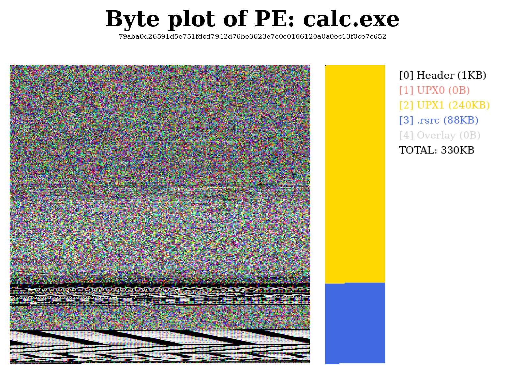
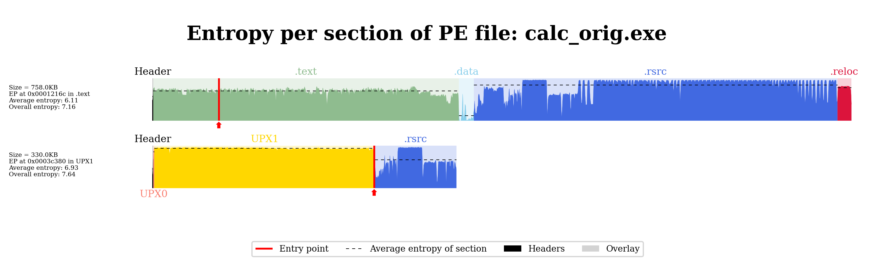
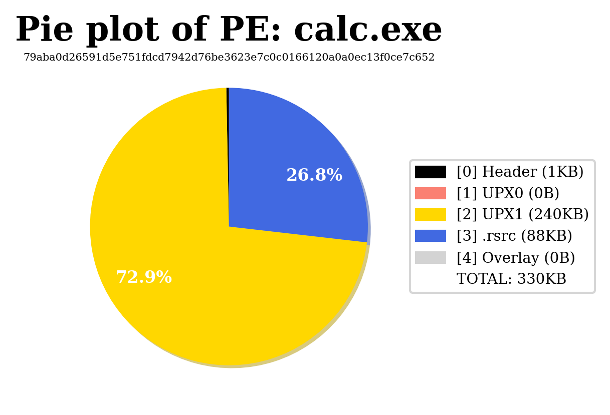
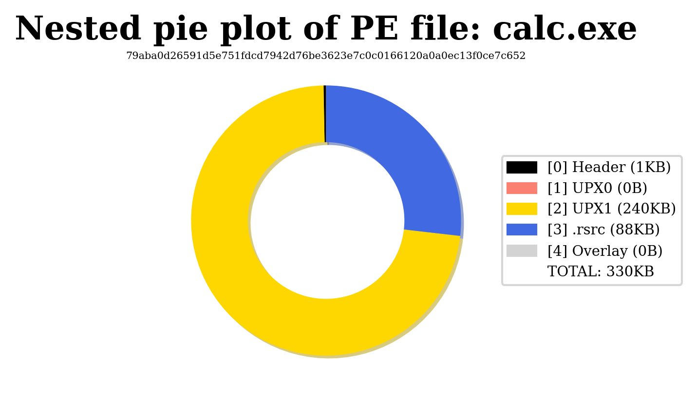

# `exeplot`: plot executables

`exeplot` draws one plot type of one or more executables and saves it as an
image in the current directory.

```console
$ exeplot [-h] [-v] {byte,diff,entropy,graph,nested_pie,pie} ...
```

| Option | Description |
|---|---|
| `-v`, `--verbose` | Show debug information. |
| `-h`, `--help` | Show the help message and exit. `exeplot <plot> -h` shows the options of one plot type. |

## Common options

Every plot type accepts these options:

| Option | Description |
|---|---|
| `--no-title` | Do not display the title. |
| `--no-legend` | Do not display the legend. |
| `-i`, `--interactive-mode` | Open a Python console before saving, to edit the figure with `plt` (see the note below). |
| `-h`, `--help` | Show the help message of the plot type and exit. |

!!! note "Interactive mode"
    In the console, the figure is not saved yet. Edit it with `plt`, then
    either leave the console (`Ctrl+D`) to let `exeplot` save it, or save it
    yourself with `plt.savefig(img, **kw_plot)`.

## Output

The image is written to `<name>_<plot>.png`, where `<name>` is the file name
of the first executable without its extension. For example,
`exeplot pie samples/calc.exe` writes `calc_pie.png`. An existing file is
overwritten.

The format, resolution and other saving options come from the
[configuration file](#configuration-file).

## Plot types

### `byte`

Draws the raw bytes as a square image, with a side bar that shows where
each section lies and a legend of the sections.

```console
$ exeplot byte [-g] [--no-legend] [--no-title] [-h] [-i] executable
```

| Option | Description |
|---|---|
| `executable` | The executable to plot. |
| `-g`, `--grayscale` | One byte per gray pixel, instead of three bytes per RGB pixel. |

With `--no-legend`, the side bar is left out too.



### `entropy`

Plots the entropy along the file, from 0 to 8 bits per byte. Each section
is filled with its own color, its average entropy is a dashed line, and the
entry point is a red arrow. With several executables, one plot per file is
stacked.

```console
$ exeplot entropy [-l [LABELS ...]] [--sublabel {ep,size,size-ep,size-ent,size-ep-ent}] [-s] [-t TARGET]
                  [--no-entrypoint] [--no-label] [--no-legend] [--no-title] [-h] [-i]
                  executable [executable ...]
```

| Option | Default | Description |
|---|---|---|
| `executable` | | One or more executables to plot. |
| `-l`, `--labels` | file names | Custom labels for the executables, in the same order. |
| `--sublabel` | `size-ep-ent` | Text under each label: the size (`size`), the entry point and its section (`ep`), the average and overall entropy (`ent`), combined with `-`. |
| `-s`, `--scale` | off | Draw every file on the scale of the first one, so that their lengths can be compared. |
| `-t`, `--target` | first file name | Name shown in the title. |
| `--no-entrypoint` | off | Do not display the entry point. |
| `--no-label` | off | Do not display the labels, sublabels and section names. |

```console
$ exeplot entropy calc_orig.exe calc_packed.exe
```



```console
$ exeplot entropy calc_packed.exe --no-title --no-legend --no-label --no-entrypoint
```


### `pie`

Draws the share of the file taken by each section, the headers and the
overlay. Gaps between sections are left white.

```console
$ exeplot pie [--donut] [--no-label] [--no-legend] [--no-title] [-h] [-i] executable
```

| Option | Description |
|---|---|
| `executable` | The executable to plot. |
| `--donut` | Draw a donut instead of a pie. |
| `--no-label` | Do not display the percentages. Only shares of 2% or more are labeled anyway. |



### `nested_pie`

Like `pie`, but sections that overlap are drawn on extra rings instead of
being cut. For ELF and Mach-O files, the segments are drawn as inner rings.

```console
$ exeplot nested_pie [--no-legend] [--no-title] [-h] [-i] executable
```



### `diff`

Compares an executable with a modified version of it, for example the
same program before and after packing. Both files are drawn as bars with
their sections, and every byte range is colored as removed, modified,
untouched or added.

```console
$ exeplot diff [--no-colormap] [--no-legend] [--no-title] [-h] [-i] executable executable2
```

| Option | Description |
|---|---|
| `executable` | The reference executable. |
| `executable2` | The modified executable. It must have the same format. |
| `--no-colormap` | Do not display the color bar that explains the four colors. |

!!! warning
    The comparison (`difflib.SequenceMatcher`) can take a long time on large
    files. If [joblib](https://joblib.readthedocs.io) is installed, its
    result is cached in `~/.exeplot`.

### `graph`

Draws the control flow graph of the executable. Basic blocks that start a
function are red, the others are light blue. Needs the
[`graph` extra](../installation.md#the-graph-extra).

```console
$ exeplot graph [-a {emulated,fast}] [-e {default,pcode,vex}] [--no-legend] [--no-title] [-h] [-i] executable
```

| Option | Default | Description |
|---|---|---|
| `executable` | | The executable to plot. |
| `-a`, `--algorithm` | `fast` | angr's CFG recovery: `fast` (static, `CFGFast`) or `emulated` (symbolic execution, `CFGEmulated`, slower). |
| `-e`, `--engine` | `default` | angr's lifting engine: `default`, `pcode` or `vex`. |

This plot has no title nor legend, so `--no-title` and `--no-legend` have
no effect.

## Configuration file

`exeplot` reads `~/.exeplot.conf`, if it exists, before each plot. Options
go in a `[Plot style]` section:

```ini
[Plot style]
dpi = 150
font_family = sans-serif
font_size = 12
img_format = svg
shadow = False
```

| Option | Default | Description |
|---|---|---|
| `bbox_inches` | `tight` | Bounding box of the saved figure ([`savefig`](https://matplotlib.org/stable/api/_as_gen/matplotlib.pyplot.savefig.html)). |
| `colormap_main` | `RdYlGn_r` | Matplotlib colormap of the figure. |
| `dpi` | `300` | Resolution of the image. |
| `font_family` | `serif` | Font family of every text. |
| `font_size` | `10` | Base font size. Titles and labels are scaled from it. |
| `img_format` | `png` | Image format and file extension, for example `svg` or `pdf`. |
| `shadow` | `True` | Draw a shadow under the pie charts. |
| `transparent` | `False` | Save the image with a transparent background. |

Values are converted to the type of the default. An invalid file, or a value
that cannot be converted, raises a `ValueError`.
